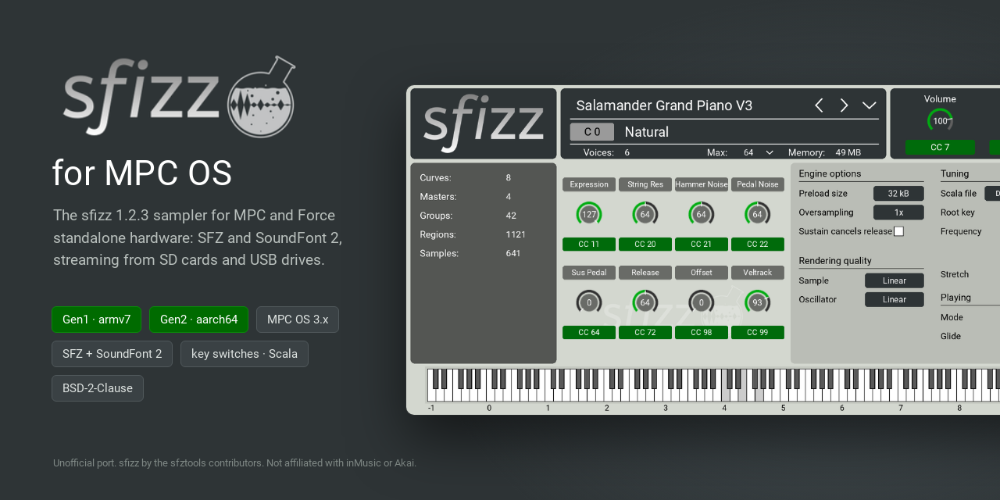
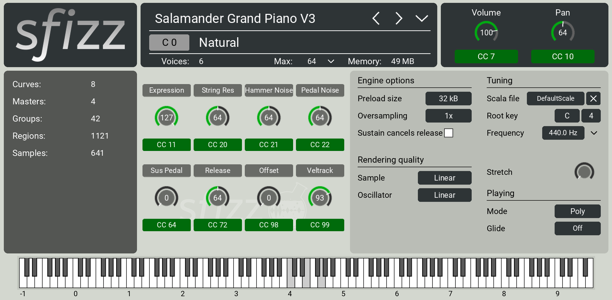
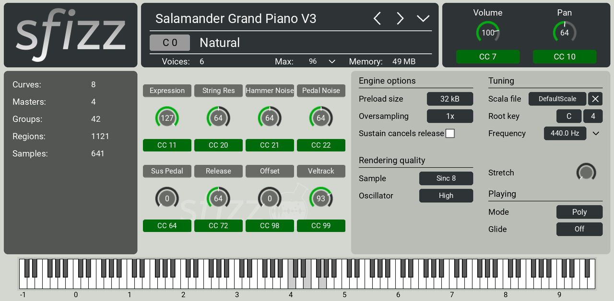
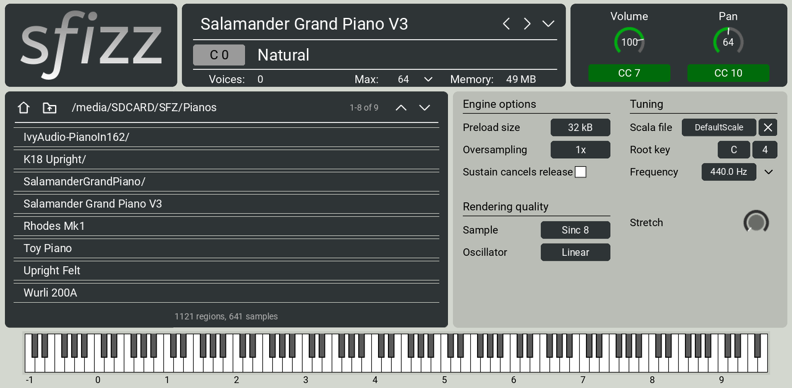
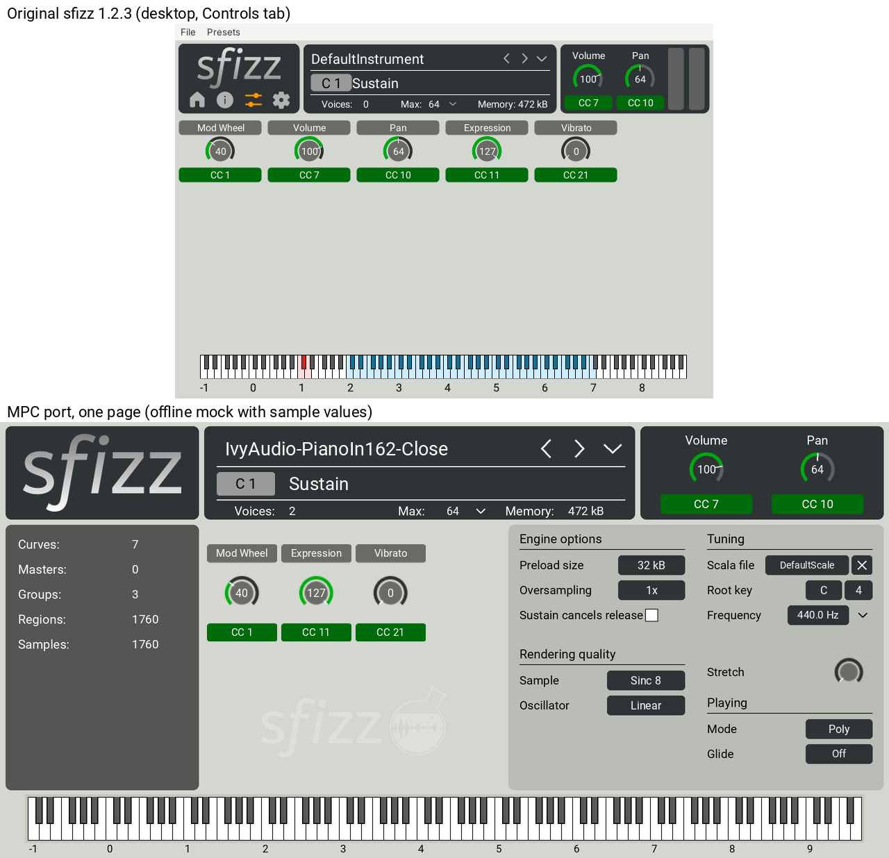
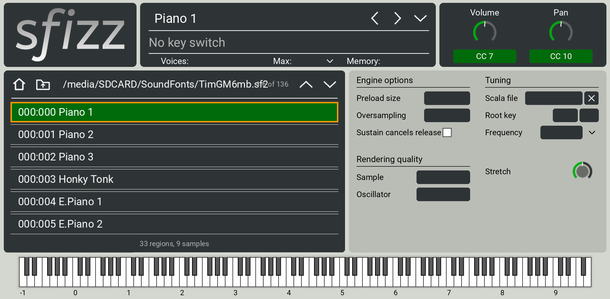
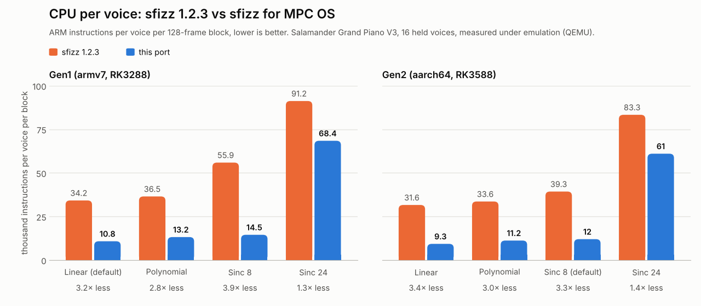

<p align="center"></p>

<p align="center">
  <a href="../../releases/latest"></a>
  
  
  
  <a href="LICENSE"></a>
</p>

# sfizz for MPC OS

The [sfizz](https://github.com/sfztools/sfizz) 1.2.3 SFZ sampler as a native instrument plugin for MPC OS standalone
hardware, on a one-page screen modelled on sfizz's own editor. It plays SFZ libraries and SoundFont 2 (`.sf2`) files
from SD cards and USB drives, streamed from disk, with key switches, the instrument's own CC controls and Scala tuning. Built on
[mpc-vst-plugins](https://github.com/sd88me/mpc-vst-plugins) (VST2 wrapper, skin tools, installer, plugin catalog).
Requires a modded unit with root access, as every plugin from that project does.

**Download** from [Releases](../../releases) — the zip for your device:

| Device | CPU | Zip |
|---|---|---|
| **Gen1**: MPC Live / Live II, One, X, Key 61, Force | RK3288, 32-bit | `sfizz-<version>-mpc-armv7.zip` |
| **Gen2**: MPC Live III and other RK3588 units | RK3588, 64-bit | `sfizz-<version>-mpc-aarch64.zip` |
| **Gen1**, installed with `vstscanner.sh` (Force VST distribution) | RK3288, 32-bit | `sfizz-for-MPC-OS-<version>.zip` |

The `-mpc-` zips have an installer that checks the zip against the device and names the right one if it doesn't match.
The `for-MPC-OS` zip is the same Gen1 plugin as a plain folder, for setups that register plugins with `vstscanner`. **Manual:**
[docs/MANUAL.pdf](docs/MANUAL.pdf).



## Install
**With the installer** (`sfizz-<version>-mpc-armv7.zip` or `-mpc-aarch64.zip`):
1. Unzip, copy the `sfizz-<version>` folder to the device: `scp -r sfizz-1.0.4 root@<device-ip>:/tmp/`
2. Run the installer: `ssh root@<device-ip> sh /tmp/sfizz-1.0.4/install.sh` (it stops and restarts MPC: save first).
3. Add **sfizz** to a track from the plugin browser, or from Sounds › INSTRUMENTS (its sfizz tile, then Default). Tap ⌄
   to open an SFZ from an SD card or USB drive.

**With `vstscanner`** (Gen1, `sfizz-for-MPC-OS-<version>.zip`; the zip's README has the details and other firmware):
1. Copy the `sfztools - VST - sfizz` folder into the `Synths` folder on your card, next to `vstscanner.sh`
   (MockbaMod: `/media/662522/Synths`).
2. Point the Instruments tile's Default preset at that folder:
   `ssh <device-ip> "sed -i 's|%payload-path%|/media/662522/Synths|' '/media/662522/Synths/sfztools - VST - sfizz/Presets/0000-Default.xpl'"`
3. Run the scanner: `ssh <device-ip> 'sh /media/662522/Synths/vstscanner.sh'` (later just `vstscanner`). MPC restarts;
   sfizz is under manufacturer "sfztools".

Use one method per device: the scanner rebuilds MPC's whole plugin list from the folders it finds.

Requirements: MPC OS 3.x and root SSH. The installer zip's `INSTALL.md` also has the manual steps. `uninstall.sh` removes it and
keeps the SFZ files you put in its library folder. Or install it from the
[MPC OS plugin catalog](https://github.com/sd88me/mpc-vst-plugins), which picks the right zip for the device by itself.

## Gen1 and Gen2
The two builds are the same plugin: same screen, same parameters, same plugin ID, so projects move between devices.
Gen2 has several times Gen1's CPU and memory, so a new sfizz there starts with higher quality settings:

| New instance defaults | Gen1 (armv7) | Gen2 (aarch64) |
|---|---|---|
| Sample quality | Linear | **Sinc 8** |
| Oscillator quality | Linear | **High** |
| Max voices | 64 | **96** |
| Decoded-sample memory | a third of free memory, up to 384 MB | a third of free memory, up to **1 GB** |
| Streaming read-ahead | 1.25 s | **2 s** (more slack for slow drives) |

Everything can still be set on the screen, and a saved project keeps its own settings on either generation. On Gen2,
Sinc 8 costs about 1.3× Linear's CPU and is far cleaner on samples played away from their root note.

Both builds have been tested on hardware: an Akai Force (Gen1) and an MPC Live III (Gen2), both on MPC OS 3.9.1
([tested.json](tested.json)).

<p align="center"></p>

## What's on the page
sfizz's editor has four tabs; on the MPC they sit side by side on one page, under the same header and over the same piano:

| sfizz | Here |
|---|---|
| File box: name, ‹ › (previous / next SFZ in the folder), ⌄ menu | Same. ⌄ opens the SFZ browser over the left half of the page |
| Key switch badge and label, "No key switch" | Same |
| Voices / Max / Memory | Same; Max is a drop-down |
| Volume (CC 7) and Pan (CC 10) knobs | Same |
| Information tab | Left panel: Curves, Masters, Groups, Regions, Samples |
| Controls tab | Middle panel: the instrument's CC knobs (its `label_cc` names, CC badges), up to 8 |
| Settings tab | Right panel: Engine options, Rendering quality, Tuning (Scala file, root key, frequency with the historical presets, stretch), and Playing: Mono / Legato with Glide (this port's addition) |
| Piano | Same strip; keys show pressed while their notes are held, as in sfizz (a display: not playable by touch) |

Left out, because they mean nothing on the MPC: the volume meters, Theme, Zoom, the "when freewheeling" quality rows
(MPC never freewheels), and the file menu's Edit / Create / Open folder entries.

**Q-Links**: Volume, Pan, the 8 CC knobs, Frequency, Stretch, Sample and Oscillator quality, Mode, Glide.

**Mono, Legato and Glide** (Settings › Playing) make any instrument monophonic: **Mono** retriggers each note,
**Legato** moves the sounding note to the new pitch without a new attack, and **Glide** (Off to 2 s) slides the pitch
between notes. Letting go of the newest note returns to the one still held. sfizz has neither of these itself: the
plugin keeps the held notes and adds a per-voice pitch glide to the engine (`src/VENDORED.md`). Instruments with their
own legato samples (SFZ `trigger=legato`) play their legato in Poly mode.

The drop-down lists (Max, Preload size, Oversampling, Sample and Oscillator quality, Root key, the historical tuning
presets) open large for the touchscreen: 46 px rows with 20 px text, in as few columns as fit beside their field. The
SFZ browser is sized for fingers too: six 43 px rows per page, with 44 px Home, Up and page buttons, and the file box's
‹ › ⌄ are 44 px touch targets.





## Instruments
The browser lists the plugin's own library (`sfizz/Instruments` inside the plugin folder), every SD card and USB drive
(`/media/*`) and `/sdcard`. Tap a folder to open it, an SFZ to load it; the loaded one is lit green. ‹ › in the header step
through the SFZ files of the loaded one's folder.

**SoundFonts (`.sf2`)** open like folders: tap one and the browser lists its presets as `bank:program name`
(`000:000 Piano 1`); tap a preset to load it. The first time, the preset is converted into an SFZ instrument and WAV
samples in the plugin's `sfizz/SF2 Cache` folder, which takes a moment for big presets; after that it loads at once.
‹ › step through the SoundFont's presets, and a **MIDI program change** (with the bank from CC 0) picks a preset of the
loaded SoundFont, as SoundFont players do. The conversion follows the SoundFont 2.04 rules (key and velocity splits,
loops, tuning, envelopes, filter, LFOs, exclusive classes); custom SF2 modulators beyond the standard ones aren't
converted, and compressed SF3 files aren't read. The cache keeps up to 1 GB, dropping the least recently used
SoundFonts first; deleting the folder is always safe.

 A project saves the file by path and finds it by name if the card or
folder moved. Scala files (`.scl`) go in `sfizz/Scales`; the Scala file button steps through them, × resets to equal temperament.

Samples stream from disk (sfizz's preload + streaming), so libraries larger than the MPC's memory play in full; raise
Preload size if a slow card gives dropouts at note starts. A good free library to start with:
[Salamander Grand Piano V3](https://github.com/sfzinstruments/SalamanderGrandPiano) (16 layers, 24-bit FLAC, CC BY 3.0).

## CPU and memory
sfizz normally reads the whole rest of a sample file the moment a key is hit, on a real-time thread, and keeps it with no
memory limit: with big piano libraries that spiked the MPC's CPU to 100% on every note, and enough chords could exhaust
memory. This port streams files a little ahead of each note on a normal-priority thread, within a memory budget; when it
runs out, the notes that have played longest fade out first. Rendering takes about a third of the instructions per voice
that upstream sfizz needs at the everyday qualities (NEON paths, stages merged into single passes, unused work skipped), with
the same sound. Details in `src/VENDORED.md`, measurements in [TESTING.md](TESTING.md).



## Sound quality
Polynomial (sfizz's desktop default) and Sinc 8 are cleaner than Linear on samples pitched far from their root (Sinc 8
removes about 24 dB of interpolation distortion over Polynomial on samples pitched down, measured offline); Sinc 24 and
up are cleaner still, for more CPU per voice. Samples are kept in 32-bit float, so 24-bit libraries keep their depth.
The output matches upstream sfizz 1.2.3 built for the same CPU: on Gen1 bit-identical at every quality but Sinc 8
(within 10⁻⁷); on Gen2 within 3 × 10⁻⁸, and 10⁻⁷ at Sinc 8 — floating-point rounding order, far
below anything audible.

## Build
```
pip install ziglang==0.13.0        # the cross compiler for both builds (glibc 2.28 target)
git clone https://github.com/sd88me/mpc-vst-plugins && git -C mpc-vst-plugins checkout e18a0a1da84515096d354f399dd4cd7f9c079fb5
MPC_VST=$PWD/mpc-vst-plugins HTML_ART_PYTHON=/path/to/python-with-playwright-and-pillow ./build.sh
```
`build.sh skin` draws the art (`design.py`) and builds the skin; `build.sh so` builds the Gen1 `build/sfizz_mpc.so`,
`build.sh so64` the Gen2 `build/aarch64/sfizz_mpc.so`, `build.sh` all three. Tests are in [TESTING.md](TESTING.md);
releasing and the catalog are in [CLAUDE.md](CLAUDE.md) and [docs/RELEASE_AGENT.md](docs/RELEASE_AGENT.md)
(instructions for people and agents alike).

## Files
- `src/sfizz_mpc.cpp`: the engine adapter (sfizz → `mpc_engine()`); `src/sfizz/`: vendored sfizz 1.2.3 (`src/VENDORED.md`)
- `src/sf2_sfz.cpp`: SoundFont 2 → SFZ conversion (preset list, cached SFZ + WAV per preset)
- `params.json`: the parameters, in VST index order (never reorder: projects store values by index)
- `design.py` → `art/`, `layout.conf`; `skin_post.py`: TUI.json touch-ups (Roboto text, values inside knobs)
- `data/`: the plugin's `sfizz/` folder (default instrument and scale, empty library folders)
- `tests/`, `tools/`: offline tests (x86 host test libraries, VST2 host under QEMU for both builds, screen mock,
  `make_images.py` for the pictures here)
- `tools/package.sh`: the release files (both installer zips, the standalone zip, the manual, `SHA256SUMS`)
- `packaging/catalog/sfizz.json`: the MPC OS plugin catalog entry; `packaging/standalone-README.md`: the standalone
  zip's README; `docs/`: manual, screenshots, release guide; `NOTICE.md`: components and licences

## Credits and licence
sfizz is by the [sfztools](https://github.com/sfztools) contributors; this port uses its 1.2.3 engine with documented
changes to sample streaming, memory and speed (`src/VENDORED.md`) and draws its screen after sfizz's editor (logo and
emblem from sfizz-ui's resources, Roboto). It is not an official sfztools release. BSD-2-Clause (`LICENSE`), as sfizz;
sfizz's dependencies keep their own licences (`src/sfizz/external`); Roboto is Apache-2.0. MPC and Force are trademarks
of inMusic; this project is not affiliated with inMusic or Akai.
